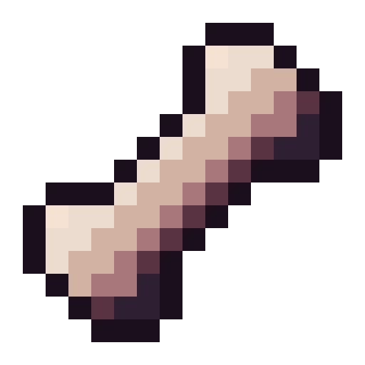

<p align="center"></p>

# Nyx Loader

Mod loader client-side para Minecraft Java Edition. Em desenvolvimento.

**Versão atual: 0.0.3** — suporta apenas o Minecraft **1.7.10**, com **Java 8**.

## Como funciona

O Nyx roda sobre o LaunchWrapper 1.12 (`net.minecraft.launchwrapper.Launch`), o mesmo mecanismo usado pelo Forge nessa versão.

1. O launcher inicia o jogo com `net.minecraft.launchwrapper.Launch` e `--tweakClass dev.nyx.loader.NyxTweaker`.
2. O `NyxTweaker` registra o transformador de bytecode, procura mods em `<pasta do jogo>/mods/*.jar` e repassa a execução para `net.minecraft.client.main.Main`.
3. O `NyxClassTransformer` injeta hooks usando ASM:
   - `bao.ag()V` (fim da inicialização): inicializa os mods;
   - `bao.p()V` (início de cada tick do cliente): tick listeners;
   - `bao.g()V` (antes de `Display.update()`): fim de cada frame, usado para o HUD, as teclas e o FPS;
   - `bee` (menu principal): desenha e trata o clique do botão do ModMenu.
4. Se os métodos esperados não forem encontrados (outro build do jogo), o hook não é aplicado e um aviso aparece no log.

Os nomes ofuscados acima foram verificados no `client.jar` do Minecraft 1.7.10 (sha1 `e80d9b3bf5085002218d4be59e668bac718abbc6`).

## Criando um mod

Estrutura mínima do `.jar`:

```
nyx.mod.properties
seu/pacote/MeuMod.class
```

`nyx.mod.properties`:

```
id=meu-mod
name=Meu Mod
version=0.0.1
entrypoint=seu.pacote.MeuMod
```

`id` aceita apenas `a-z`, `0-9`, `_` e `-`. Todo o resto é opcional e aparece no ModMenu:

```
name=Meu Mod
version=0.0.1
description=O que o mod faz.
authors=Autor 1, Autor 2
license=MIT
website=https://exemplo.com
issues=https://exemplo.com/issues
icon=assets/meumod/icon.png
```

`icon` é o caminho de um PNG dentro do `.jar`.

```java
public class MeuMod implements NyxMod {

    @Override
    public void onInitialize() {
        Nyx.onClientTick(this::tick);
    }

    private void tick() {
    }
}
```

API da 0.0.3 (`dev.nyx.api.Nyx`):

| Método | O que faz |
| --- | --- |
| `onClientTick(Runnable)` | roda a cada tick do cliente |
| `onHud(HudRenderer)` | desenha por cima do jogo a cada frame (`NyxGraphics`: `fillRect`, `drawString`, `stringWidth`, `width`, `height`, `fps`, `frameTimeMillis`, `inGame`, `screenOpen`) |
| `registerKey(modId, nome, tecla, Runnable)` | atalho de teclado; a tecla pode ser trocada em `config/nyx/keys.properties` |
| `getConfig(modId)` | `NyxConfig` em `config/nyx/<id>.properties` (`get`, `getInt`, `getBoolean`, `set`, `setDefault`, `save`) |
| `getFps()` | FPS atual |
| `getGameDirectory()`, `getModsDirectory()`, `getConfigDirectory()` | pastas |
| `isModLoaded(String)`, `log(String)` | utilidades |

Ações de teclas só disparam sem nenhuma tela aberta.

Classes do LWJGL 2 (`Display`, `Keyboard`, `Mouse`, `GL11`) podem ser usadas diretamente. Classes do Minecraft são ofuscadas nesta versão e ainda não há camada de mapeamentos.

Dependências do mod (escopo `provided`): `dev.nyx:nyx-loader` e `org.lwjgl.lwjgl:lwjgl:2.9.1`. Veja `examples/`.

## ModMenu

O Nyx adiciona um botão com o ícone do osso no canto superior direito do menu principal. Dentro do jogo, **Shift direito** abre o mesmo menu. A tela tem barra de pesquisa, filtro (tudo, mods, bibliotecas), lista de mods à esquerda e os detalhes do mod selecionado à direita (ícone, versão, autores, descrição, licença, arquivo, Site e Issues). Nesta versão o botão de abrir a pasta e os links tentam o navegador do sistema; se ele não existir (Android), o endereço aparece na tela e é copiado para a área de transferência. A tela segue o idioma de `options.txt` (português ou inglês).

## Exemplos

- `examples/hello-nyx`: escreve no log e muda o título da janela.
- `examples/session-timer`: mostra o tempo de sessão no título da janela, atualizado pelo hook de tick.
- `examples/fps-counter`: mostra FPS e tempo do quadro no canto da tela com `onHud`. **F6** liga e desliga; `config/nyx/fps-counter.properties` define o canto (`top-left`, `top-right`, `bottom-left`, `bottom-right`), o fundo e o tempo do quadro.
- `examples/log-probe`: cria `logs/nyx-probe.log` na pasta do jogo (versão, Java, pasta e ticks), útil para confirmar que o Nyx está rodando.

## Compilar

Requer JDK 17 ou superior, Maven e Python 3.

```
mvn package
bash scripts/package-release.sh 0.0.3
```

A saída fica em `dist/`. O GitHub Actions faz o mesmo a cada push e, ao enviar uma tag `v*`, publica um Release.

## Instalar no Fold Craft Launcher (FCL)

1. No FCL, instale o Minecraft **1.7.10** normal com o nome **Nyx-1.7.10** e abra-o uma vez.
2. Baixe `Nyx-0.0.3-install.zip` (Releases) ou `Nyx-1.7.10.json` (pasta `dist/`).
3. Extraia o zip na pasta do jogo do FCL (a que contém `versions` e `libraries`), mesclando as pastas e substituindo o `Nyx-1.7.10.json`.
4. Atualize a lista de versões, selecione **Nyx-1.7.10** e use Java 8.
5. Os mods de exemplo vão para `versions/Nyx-1.7.10/mods` (versão isolada). Sem isolamento, copie para `mods/` na raiz.
6. Procure linhas começando com `[Nyx]` no log, ou o arquivo `logs/nyx-probe.log`.

O `Nyx-1.7.10.json` usa o formato do FCL: a versão vanilla fica no patch `game` e o Nyx (LaunchWrapper, ASM e `nyx-loader`) no patch `nyx`, com `mainClass` `net.minecraft.launchwrapper.Launch` e `--tweakClass dev.nyx.loader.NyxTweaker` nos argumentos.

## Limitações da 0.0.3

- Somente Minecraft 1.7.10 e somente cliente.
- Sem camada de mapeamentos: as classes do Minecraft continuam ofuscadas. O HUD e o ModMenu usam OpenGL (LWJGL) e a fonte do jogo.
- Sem verificação de dependências entre mods.
- Testado em Linux com Java 8 (incluindo cliques simulados no ModMenu); em launchers Android o teste da 0.0.2 passou, o da 0.0.3 ainda não.

## Licença

Veja `License.txt`.

## Biblioteca no repositório

O JSON do FCL baixa `nyx-loader` de `maven/dev/nyx/nyx-loader/<versão>/` (via `raw.githubusercontent.com`, branch `v<versão>`), então essas branches precisam continuar existindo.
